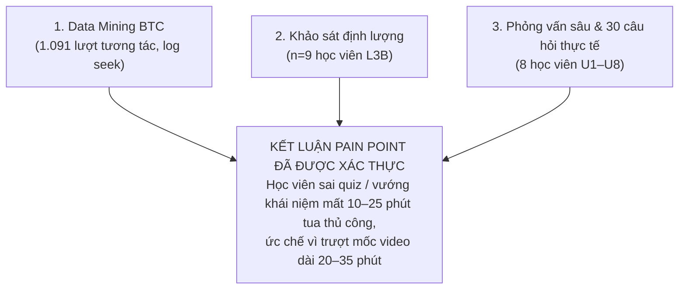

# Bằng chứng CP3 — Bằng chứng nỗi đau & 5 trích dẫn nguyên văn người học

> **Nhóm:** Day dứt nỗi đau · **Lớp:** L3B · **Track:** A1 (EdTech)  
> **Bài toán:** Trợ Lý Điều Hướng Video Bài Giảng (*Smart Video Concept Seek*)  
> **Lát cắt:** Khi học viên làm sai quiz hoặc vướng khái niệm trong bài pre-class, trợ lý AI đối chiếu câu hỏi với transcript 3 video bài giảng để trích đúng đoạn và dẫn link nhảy thẳng đến mốc thời gian đó trong tối đa 2 lần nhấn.

---

## 1. Bằng chứng chứng minh vấn đề người dùng gặp phải

Vấn đề của người dùng (Pain point) đã được chứng minh **rõ ràng, mạnh mẽ và nhất quán** thông qua phương pháp **Tam giác hóa dữ liệu (Triangulation)** kết hợp 3 nguồn độc lập:

### A. Dữ liệu hành vi hệ thống (System logs & Data mining từ BTC)
- **Cờ thiếu ngữ cảnh (`missing_context`):** Có **98 / 1.091 lượt câu hỏi** (chiếm **9,0%**) bị hệ thống đánh cờ `missing_context=true`, với **49 / 143 học viên** gặp tình trạng này ít nhất một lần. Điều này phản ánh rào cản rất lớn: người học khi vướng mắc thường hỏi cụt lủn hoặc không nhớ rõ tên bài/khái niệm, dẫn đến trợ lý trả lời chung chung hoặc lệch trọng tâm.
- **Hành vi tua lùi nhiều lần (Backward Seek Chains):** Phân tích chuỗi seek của học viên ghi nhận các trường hợp tua giật lùi liên tiếp trong thời gian ngắn để cố tìm kiếm một đoạn kiến thức.  
  *Ví dụ điển hình:* Bản ghi `A01767` thực hiện chuỗi 3 lần tua lùi dồn dập chỉ trong 13 giây:
  - 06:02:22 UTC: Tua từ **283,7s** về **189,4s** (lùi 94,3 giây)
  - 06:02:25 UTC: Tua từ **189,4s** về **114,8s** (lùi 74,6 giây)
  - 06:02:35 UTC: Tua từ **114,8s** về **84,2s** (lùi 30,6 giây)  
  *Ý nghĩa:* Người học không biết chính xác mốc thời gian của khái niệm nên phải liên tục bấm lùi thanh seekbar để "mò mẫm" nội dung bài giảng.

### B. Khảo sát định lượng (`evidence/survey/results.csv`, n=9)
- **7 / 9 người học (77,8%)** xác nhận gặp khó khăn khi tiếp thu bài giảng hoặc làm câu hỏi trắc nghiệm pre-class (`experienced_issue = yes`).
- **5 / 9 người học (55,6%)** chủ động chọn phương án giải quyết là xem lại/tua lại đoạn video (`rewatch_or_seek_segment`) hoặc dùng chatbot để tìm đoạn giải thích (`find_explanation_segment`, `point_to_relevant_segment`).
- **Thời gian tiêu tốn cho mỗi lần vướng:**
  - 5 / 9 học viên (55,6%) mất từ **10 – 20 phút**.
  - 3 / 9 học viên (33,3%) mất từ **20 – 40 phút** đến **hơn 1 giờ**.
- **Tần suất lặp lại:** 7 / 9 học viên gặp khó khăn với tần suất từ **2–5 lần/tháng** đến **trên 5 lần/tháng**.

### C. Phỏng vấn sâu & Tổng hợp từ 8 học viên thực tế (U1 – U8)
- Nhóm đã làm việc trực tiếp với **8 học viên lớp L3B** (`U1` đến `U8`), thu thập **30 câu hỏi thực tế** gắn liền với 3 video bài giảng (ReactJS, Harness Engineering, Transformer).
- **100% (8/8 học viên)** xác nhận nỗi đau cốt lõi: Khi làm quiz trắc nghiệm pre-class bị sai hoặc gặp khái niệm khó, họ **không nhớ nổi video dài 20–35 phút nói về phần đó ở phút thứ mấy**, việc kéo thanh seekbar thủ công thường xuyên bị trượt mốc, mất trung bình **10–25 phút** mỗi lần và gây đứt gãy mạch tư duy.

---

## 2. 5 trích dẫn nguyên văn về pain

Dưới đây là **5 trích dẫn nguyên văn** từ người học thật trong lớp L3B, phản ánh chân thực nỗi đau, sự ức chế và thời gian lãng phí khi phải tự mò tìm đoạn video sau khi làm sai quiz hoặc gặp khái niệm khó:

### Trích dẫn 1 · Học viên U1 (Frontend Newbie — Video 1: ReactJS Mounted & Unmounted)
> *"Lúc làm quiz đến câu bật tắt component bằng useState thì mình chọn nhầm. Nhớ mang máng thầy có demo đoạn Toggle show/hide mà video dài không nhớ ở phút nào. Mình phải tua tới tua lui trượt mốc bực cả mình, gấp nộp bài trước giờ học mà mò mất hơn 15 phút mới tới đoạn code thật."*
- **Bối cảnh:** Vừa làm sai câu hỏi trắc nghiệm pre-class lúc 21h30 tối trước giờ học, cần tìm đoạn demo `useState(false)` và `{show && <Content />}` trong video `Tìm hiểu về thuật ngữ Mounted & Unmounted`.
- **Số liệu kiểm chứng:** Gặp **3–4 lần/tháng** · Lần gần nhất mất **15 phút**.
- **Hồ sơ liên kết:** [evidence/users.md](file:///d:/Ai_in_Action/K5-Day15-L3B-Day-dut-noi-dau/evidence/users.md) (User U1, câu B01, B02).

### Trích dẫn 2 · Học viên U2 (React Developer — Video 1: ReactJS DOM Lifecycle)
> *"Mình làm sai câu 3 quiz pre-class về React Element trước khi render vào DOM. Biết là thầy có giải thích ở đoạn giữa video nhưng không có timestamp mục lục, ngồi bấm thanh seekbar đoán mò qua lại mất toi gần 20 phút mà vẫn lệch mất đoạn thầy vẽ sơ đồ so sánh."*
- **Bối cảnh:** Làm bài kiểm tra đầu giờ, cần đối chiếu bản chất thời điểm Mount diễn ra khi React Element hình thành trước khi vào DOM thật.
- **Số liệu kiểm chứng:** Gặp **2–3 lần/tháng** · Lần gần nhất mất **18 phút**.
- **Hồ sơ liên kết:** [evidence/users.md](file:///d:/Ai_in_Action/K5-Day15-L3B-Day-dut-noi-dau/evidence/users.md) (User U2, câu B03, B18, B19).

### Trích dẫn 3 · Học viên U4 (AI Practitioner — Video 2: Harness Engineering)
> *"Bài Harness Engineering kiến thức dày đặc, xem xong làm quiz hỏi về ngưỡng Compaction 80-90% với Prefix Caching thì bị lú. Mình mở lại video dài gần 30 phút, kéo chuột tìm từng slide giải thích AGENTS.md rất cực, mất hơn 20 phút chỉ để tìm được đúng 1 phút thầy giảng."*
- **Bối cảnh:** Vướng cơ chế nén ngữ cảnh và nạp file AGENTS.md vào System Prompt ở Video 2, tự tìm thủ công trên video dài 31 phút.
- **Số liệu kiểm chứng:** Gặp **4–6 lần/tháng** · Lần gần nhất mất **22 phút**.
- **Hồ sơ liên kết:** [evidence/users.md](file:///d:/Ai_in_Action/K5-Day15-L3B-Day-dut-noi-dau/evidence/users.md) (User U4, câu B08, B09, B15).

### Trích dẫn 4 · Học viên U5 (ML Enthusiast — Video 3: Transformer & Self-Attention)
> *"Câu hỏi tại sao Self-Attention phải chia cho căn bậc hai của 512 làm mình lúng túng. Muốn nghe lại đoạn thầy phân tích độ lệch chuẩn gradient trước Softmax nhưng video Transformer dài 35 phút không biết ở đâu. Tua trúng đoạn khác lại phải nghe lại từ đầu, mất hơn 25 phút cực kỳ ức chế."*
- **Bối cảnh:** Làm quiz về công thức Scaled Dot-Product Attention trong video 35 phút, gặp khó khăn khi tìm đoạn chứng minh toán học.
- **Số liệu kiểm chứng:** Gặp **3–4 lần/tháng** · Lần gần nhất mất **25 phút**.
- **Hồ sơ liên kết:** [evidence/users.md](file:///d:/Ai_in_Action/K5-Day15-L3B-Day-dut-noi-dau/evidence/users.md) (User U5, câu B10, B11, B12).

### Trích dẫn 5 · Học viên U8 (Non-tech Newbie — Video 3: Transformer & Masking)
> *"Mình mới học nên nhìn video kiến trúc Transformer thấy ngợp lắm, đến câu hỏi về Masked Attention dùng số -inf thì hoàn toàn bế tắc. Không biết tua về phút nào, kéo đại thanh trượt thì toàn trúng đoạn khác, mò mẫm cả nửa tiếng đồng hồ vẫn không tìm được đúng đoạn giải thích Causal Mask."*
- **Bối cảnh:** Học viên non-tech gặp khó với cơ chế Causal Masking và giá trị âm vô cùng trong Decoder, tự tua video nhưng bị lạc giữa các phân đoạn.
- **Số liệu kiểm chứng:** Gặp **3–4 lần/tháng** · Lần gần nhất mất **30 phút**.
- **Hồ sơ liên kết:** [evidence/users.md](file:///d:/Ai_in_Action/K5-Day15-L3B-Day-dut-noi-dau/evidence/users.md) (User U8, câu B17, B20, B21).

---

## 3. Bảng tổng hợp số liệu đo lường pain

| Người dùng | Vai trò | Lần gần nhất mất | Tần suất / tháng | Hành vi khi vướng | Hậu quả tự mô tả |
|:---:|:---|:---:|:---:|:---|:---|
| **U1** | Frontend Newbie | 15 phút | 3–4 lần | Kéo seekbar qua lại, trượt mốc code demo | Bực mình, gấp nộp bài trước giờ học |
| **U2** | React Developer | 18 phút | 2–3 lần | Đoán mò vị trí giữa video, tìm sơ đồ | Lãng phí 20 phút, không thấy đúng đoạn |
| **U4** | AI Practitioner | 22 phút | 4–6 lần | Kéo chuột dò từng slide trên video 31 phút | Mất hơn 20 phút chỉ để nghe 1 phút giảng |
| **U5** | ML Enthusiast | 25 phút | 3–4 lần | Tua trượt đoạn công thức, phải nghe lại | Ức chế, ngắt quãng mạch tư duy toán |
| **U8** | Non-tech Newbie | 30 phút | 3–4 lần | Kéo đại thanh trượt, lạc giữa các đoạn | Mò mẫm nửa tiếng, bế tắc không tìm ra |
| **Trung bình** | — | **22,0 phút** | **3,5 lần/tháng** | **Tua thủ công, không có deep link** | **Mất 77 phút/học viên/tháng vào việc tua video** |

---

## 4. Tác động (Impact) định lượng được từ bằng chứng thật

- **Quy mô ảnh hưởng:** Trong lớp L3 với khoảng **436 học viên hoạt động** (theo `cost/personas.yaml` và `evidence/data-mining.md`):
  - Số lần học viên cần tua tìm lại bài: $436 \text{ học viên} \times 3,5 \text{ lần/tháng} \approx 1.526 \text{ lượt/tháng}$.
  - Tổng thời gian lãng phí vào việc tua video thủ công: $1.526 \times 22 \text{ phút} \approx 33.572 \text{ phút} \approx \mathbf{559,5 \text{ giờ học tập/tháng}}$.
- **Giải pháp của Smart Video Concept Seek:**
  - Giảm thời gian tìm đoạn từ **22 phút** xuống dưới **10 giây** thông qua liên kết nhảy thẳng `?t=<seconds>` trong tối đa **2 lần nhấn** (Click 1: Nhận câu trả lời có link; Click 2: Bấm link nhảy đến đúng giây video).
  - Tiết kiệm hơn **98% thời gian tìm kiếm**, giúp học viên tập trung trọn vẹn vào việc hiểu bài và hoàn thành quiz.
